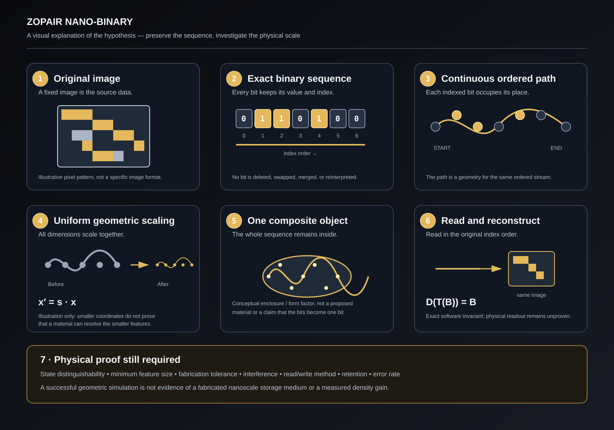

# ZOPAIR NANO-BINARY

[](docs/RESEARCH_HYPOTHESIS.md)
[](tests/)
[](LICENSE)

**A research project investigating whether a fixed binary sequence can be represented in a smaller physical geometry without changing any bit, its order, or its spatial adjacency.**

> This repository currently contains a mathematical model and software validation scaffold. It does not demonstrate a fabricated nanoscale storage medium, a working nanodevice, or a measured density improvement.

## Explainer video

A short concept illustration of the NANO-BINARY idea: a fixed binary sequence whose 0 and 1 symbols and spaces scale together by one common factor, forming one ordered thread shaped as the numeral 1.

https://github.com/user-attachments/assets/aa44f261-b90e-482e-871a-69081821d84e

*Brief concept illustration. It is a visual aid for the research concept, not a validated scientific demonstration or proof of a physical device.*

## Research question

Can a sequence of binary values be mapped onto a smaller continuous physical path while preserving every original value, exact sequence order, adjacency between consecutive positions, identifiable start/end, and exact reconstruction of the original bitstream?

The project studies **physical representation and geometry**, not information compression. It does not assume the input bits are random or independent, and it does not remove, merge, reorder, or reinterpret them.

## Core model

Let B = (b_0, ..., b_(N-1)), where every b_i is 0 or 1. The concept keeps three things explicit and unchanged:

- **Symbol identity.** Every value keeps its own symbol: a 0 stays a 0 and a 1 stays a 1. The representation never replaces the values with a new alphabet, and no value is merged into or substituted by another shape.
- **Spaces as part of the layout.** The spaces between consecutive symbols belong to the sequence layout exactly like the symbols themselves. Symbols and spaces are scaled together by one common factor.
- **Uniform scaling.** A single positive scale factor s multiplies every coordinate — symbol bodies and inter-symbol spaces alike — reducing the drawing scale of the whole layout toward the target (nano) scale. Nothing is re-proportioned; the same factor applies to every part.

With an identifiable start point and end point, the ordered sequence of symbols and spaces forms one continuous **thread**. The thread is routed so that its outer contour forms the shape of the numeral **1**. The numeral is the geometry the thread follows — the arrangement of the complete ordered sequence — not an additional bit, and not a replacement of the values by a single 1.

A representation associates each original index and value with a geometric position. The required software invariant is exact recovery: D(T(B)) = B.

**Current implementation status.** The software prototype stores each bit value with its original index and maps indices to points on a helical path, included as an **illustrative geometry only**. The symbol-shape embodiment and the numeral-1 thread routing described above are the author's concept stages: they are documented and illustrated (see the visual walkthrough) but not yet implemented in code. Existence in a simulation does not prove that matter can be fabricated, distinguished, written, retained, or read at the corresponding scale.

## Visual walkthrough

Follow the concept in seven stages, from the original image through the unchanged bitstream, geometric path, uniform scaling, composite-object concept, and exact reconstruction. The final stage separates software evidence from physical proof requirements.



See the focused illustration: [Binary field → one-shaped thread](assets/binary-field-to-one-thread.svg). It shows a binary field on the left and the same ordered values routed as one continuous thread shaped like the numeral 1 on the right. The numeral is the thread's geometry, not a replacement bit.

Read the detailed explanation: [Visual Guide](docs/VISUAL_GUIDE.md).

## Repository map

- docs/RESEARCH_HYPOTHESIS.md — precise scope and terminology.
- docs/ENGINEERING_MODEL.md — indexed-bit and scaled-path model.
- docs/VALIDATION_ROADMAP.md — staged evidence plan and failure criteria.
- src/nanobinary/binary.py — lossless byte/bit conversion.
- src/nanobinary/geometry.py — deterministic geometry simulation.
- tests/ — exact-order, byte round-trip, and scaling invariants.

## Quick start

Requires Python 3.10+; no runtime dependencies.

```bash
PYTHONPATH=src python -m unittest discover -s tests -v
```

Example:

```python
from nanobinary.binary import bytes_to_bits, bits_to_bytes

original = bytes([0, 1, 127, 128, 255])
bits = bytes_to_bits(original)
assert bits_to_bytes(bits) == original
```

The byte conversion preserves all eight bits of every byte, most-significant bit first. It does not compress or reorder data.

## What this prototype can and cannot establish

**Can establish:** deterministic indexing, preservation of binary values and order in the software model, exact byte/bit round trips, and mathematically consistent coordinate scaling.

**Cannot establish:** nanoscale manufacturability, physical separation between states, material stability, write/read error rates, energy use, endurance, thermal limits, achievable density, or superiority over existing storage technologies.

A smaller coordinate model is not, by itself, a smaller realizable storage device. Any physical claim requires a specified material system, state distinction mechanism, fabrication tolerances, read/write method, and measured results.

## Proof of Concept & Enterprise Customization Readiness

**Status:** Early research PoC — software model only. Not production hardware and not a validated storage technology.

**Current milestone:** Establish a precise, testable representation model and protect the original sequence invariants before exploring physical feasibility.

**Next milestones:** compare path geometries and tolerances; define candidate material/state mechanisms from published evidence; quantify read/write error and density; compare against established storage baselines. Each milestone must report assumptions and measured evidence separately.

## Open-source and cost policy

The prototype uses the Python standard library and GitHub Actions. No paid APIs, hosted compute, proprietary SDKs, or external runtime services are required.

## Intellectual Property & Authorship

Copyright (c) 2026 **Aly Hussein Zopair (علي حسين زبير ALY HUSSEIN ZOPAIR)**.

The NANO-BINARY concept, documentation, and this repository's original content are authored by Aly Hussein Zopair and released as open source under the MIT License (see LICENSE). This notice identifies the project author as supplied by the repository owner. It does not assert patentability, novelty, or ownership of third-party scientific methods or prior art.

**Contact:** zopairaly@gmail.com · alyzopairaly@gmail.com

## License

MIT — see LICENSE. Scientific claims, experimental results, and third-party materials must retain their respective attribution and license terms.
