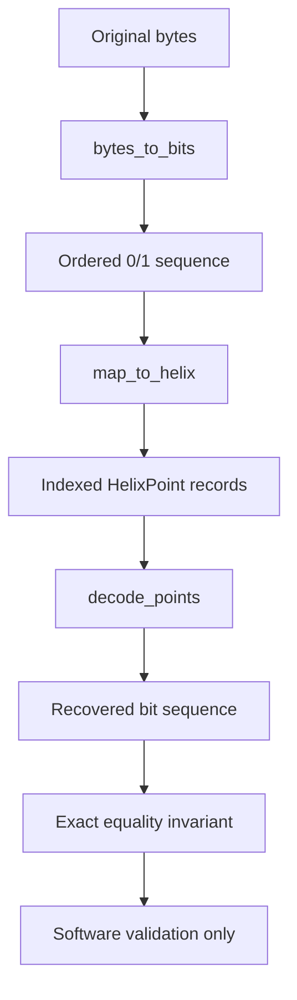

# ZOPAIR NANO-BINARY

[](docs/RESEARCH_HYPOTHESIS.md)
[](tests/)
[](https://www.python.org/)
[](LICENSE)

**A research project investigating whether a fixed binary sequence can be represented in a smaller physical geometry without changing any bit, its order, or its spatial adjacency.**

> **Research boundary:** This repository contains a mathematical model, deterministic geometry simulation, and software validation scaffold. It does not demonstrate a fabricated nanoscale storage medium, a working nanodevice, or a measured density improvement.

## 1. Project Overview & Problem Statement

The research question is whether a finite binary sequence can be mapped onto a smaller continuous physical path while preserving:

- Every original binary value and its index.
- Exact sequence order and adjacency between consecutive positions.
- Identifiable start and end points.
- Exact reconstruction of the original bitstream.
- A consistent scale factor applied to the complete geometric layout, including inter-symbol spacing.

This is a study of **physical representation and geometry**, not information compression. The software does not remove, merge, reorder, or reinterpret bits.

### Core concept

Let (B=(b_0,\ldots,b_{N-1})), where each (b_i\in\{0,1\}). The concept keeps the values and their order unchanged. Symbols and the spaces between them scale together under one common positive factor. The ordered symbols and spaces form a continuous thread between an identifiable start and end; the author's concept routes its outer contour into the shape of the numeral 1. The numeral is the thread's geometry, not an extra bit and not a replacement for the original sequence.

**Important implementation distinction:** the current code attaches each bit value to its original index and maps the index to a point on an illustrative helix. The symbol-shape embodiment and numeral-1 thread routing are documented concept stages, not implemented code.

### Current software architecture



The helix is a deterministic geometry model. The decoder reads the stored bit values and indices; it does not infer bits from physical shapes or coordinates.

## 2. Tech Stack & Versions

| Area | Current implementation |
|---|---|
| Language | Python 3.10+ |
| Runtime dependencies | Python standard library only |
| Binary conversion | `src/nanobinary/binary.py` |
| Geometry simulation | `src/nanobinary/geometry.py` |
| Data model | Frozen, slotted `HelixPoint` dataclass |
| Mathematical functions | Python `math` module |
| Tests | Python `unittest` |
| Documentation | Markdown research notes and SVG concept diagrams |
| License | MIT |

No third-party Python runtime package is required by the documented quick start.

## 3. Prerequisites & Dependencies

- Python 3.10 or newer.
- Git.
- No database, model download, external API, paid service, GPU, or hosted runtime is required.

The prototype uses only the Python standard library. The repository's MIT license applies to the project code and documentation subject to the license terms; third-party assets and materials retain their own applicable rights.

## 4. Installation & Local Setup

Clone the repository:

```bash
git clone https://github.com/zopair/ZOPAIR-NANO-BINARY.git
cd ZOPAIR-NANO-BINARY
```

Run the test suite:

```bash
PYTHONPATH=src python -m unittest discover -s tests -v
```

Run a small byte/bit round-trip example:

```python
from nanobinary.binary import bytes_to_bits, bits_to_bytes

original = bytes([0, 1, 127, 128, 255])
bits = bytes_to_bits(original)
assert bits_to_bytes(bits) == original
```

To use the geometry model:

```python
from nanobinary.binary import bytes_to_bits
from nanobinary.geometry import map_to_helix, decode_points

bits = bytes_to_bits(b"nano")
points = map_to_helix(bits, radius=1.0, pitch=0.25, scale=0.5)
assert decode_points(points) == bits
```

The example demonstrates exact software recovery only. It does not represent a fabricated or physically readable storage device.

## 5. Environment Variables

No environment variables, API keys, credentials, or external service configuration are required by the current Python prototype.

The documented test and example commands run locally and do not contact external services.

## 6. Usage Guide & Core Features

### Lossless byte/bit conversion

`bytes_to_bits(data)`:
- Requires a Python `bytes` value.
- Expands each byte into eight bits, most-significant bit first.
- Preserves the original byte order.

`bits_to_bytes(bits)`:
- Accepts only a string containing `0` and `1`.
- Rejects bit strings whose length is not divisible by eight.
- Reconstructs the original bytes in order.

No compression or reordering is performed.

### Deterministic geometry simulation

`map_to_helix(bits, radius, pitch, scale, turns_per_bit)`:
- Validates the binary sequence and requires positive geometry parameters.
- Creates one `HelixPoint` for each original bit index.
- Keeps the bit and original index attached to each point.
- Applies the same scale factor to all generated coordinates.

`decode_points(points)`:
- Requires indices to be contiguous and ordered from zero.
- Rejects malformed bit values or out-of-order indices.
- Recovers the sequence from the stored bit fields.

The software invariant is:

`decode_points(map_to_helix(B)) == B`

### Research documentation and visual material

- [Research hypothesis and boundaries](docs/RESEARCH_HYPOTHESIS.md)
- [Engineering model](docs/ENGINEERING_MODEL.md)
- [Validation roadmap](docs/VALIDATION_ROADMAP.md)
- [Visual guide](docs/VISUAL_GUIDE.md)
- [Seven-stage concept illustration](assets/nano-binary-journey.svg)
- [Binary field to one-shaped thread](assets/binary-field-to-one-thread.svg)

### Explainer video

The repository includes a short concept illustration:

https://github.com/user-attachments/assets/aa44f261-b90e-482e-871a-69081821d84e

The video is an explanatory visual, not scientific evidence or a demonstration of physical storage.

## 7. Live Demo & Screenshots

There is no hosted interactive application or physical device demo. The repository provides static SVG illustrations and the concept video linked above.

The visual walkthrough presents the research concept from the original bitstream through geometric arrangement and scaling to the distinction between software evidence and physical proof requirements. These assets explain the hypothesis; they do not validate nanoscale fabrication or read/write behavior.

## 8. Testing & Verification

Run:

```bash
PYTHONPATH=src python -m unittest discover -s tests -v
```

The software validation scope covers the repository's stated invariants, including:
- Byte-to-bit and bit-to-byte round trips.
- Preservation of bit values and original sequence order.
- Deterministic index-to-coordinate mapping.
- Uniform coordinate scaling.
- Rejection of malformed bit strings and invalid or non-contiguous indexed points.

The test suite verifies software behavior only. No physical experiment, material characterization, fabrication tolerance, read/write error-rate measurement, or storage-density benchmark is included in this repository.

## What This Prototype Can and Cannot Establish

**Can establish**
- Deterministic indexing of binary values.
- Preservation of bit identity and order in the software model.
- Exact byte/bit round trips.
- Mathematically consistent coordinate scaling.

**Cannot establish**
- Nanoscale manufacturability or material stability.
- Physical separation and reliable distinction between adjacent states.
- A real write/read mechanism or its error rate.
- Energy use, endurance, thermal limits, or achievable storage density.
- Superiority over existing storage technologies.

A smaller coordinate model is not, by itself, a smaller realizable storage device. Any physical claim requires a specified material system, state distinction mechanism, fabrication tolerances, read/write method, and measured results.

## Proof of Concept & Enterprise Customization Readiness

**Status: Early research PoC — software model only. Not production hardware and not a validated storage technology.**

**Current milestone:** establish a precise, testable representation model and protect the original sequence invariants before exploring physical feasibility.

| Area | Current state |
|---|---|
| Binary conversion | Implemented |
| Indexed geometric simulation | Implemented as an illustrative helix |
| Exact software decoding | Implemented from stored bit/index records |
| Symbol-shaped physical states | Concept only; not implemented |
| Numeral-1 thread routing | Concept and visual documentation; not implemented in code |
| Fabrication and read/write mechanism | Not specified or demonstrated |
| Physical density measurements | None |
| Production deployment | Not applicable to this research scaffold |

### Research roadmap

Future work may compare straight, planar serpentine, helical, and other continuous path geometries. A credible physical evaluation must define minimum feature size, nearest-neighbor distance, curvature, tolerances, boundary conditions, readout accessibility, and measured error rates. A compact bounding box alone is not a sufficient storage-density metric.

### Change log

- **2026-11-26:** Reorganized the README into the eight-section technical guide, clarified implemented software versus concept-only stages, and documented setup, usage, verification, limitations, and authorship. No source code or research claims were changed.

## Open-source and Cost Policy

The current prototype uses the Python standard library and requires no paid APIs, hosted compute, proprietary SDKs, or external runtime services.

## Intellectual Property & Authorship

Copyright (c) 2026 **Aly Hussein Zopair (علي حسين زبير ALY HUSSEIN ZOPAIR)**.

The NANO-BINARY concept, research framing, documentation, and original repository content are attributed to Aly Hussein Zopair as stated by the repository owner. This notice does not assert patentability, novelty, or ownership of third-party scientific methods or prior art. The project code and documentation are released under the MIT License; see [LICENSE](LICENSE).
