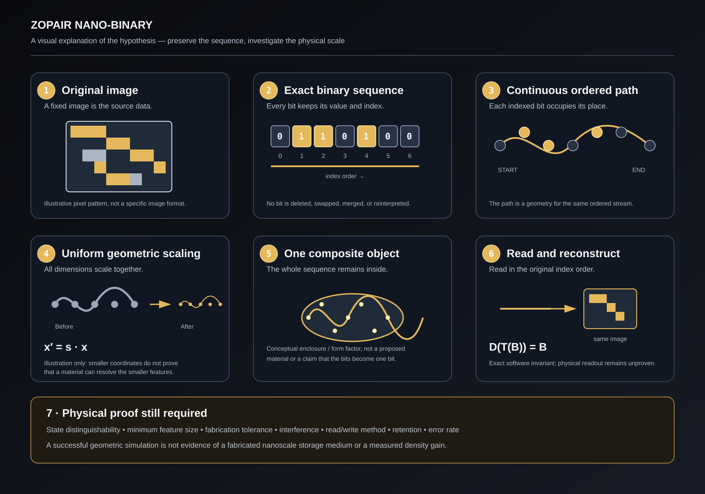
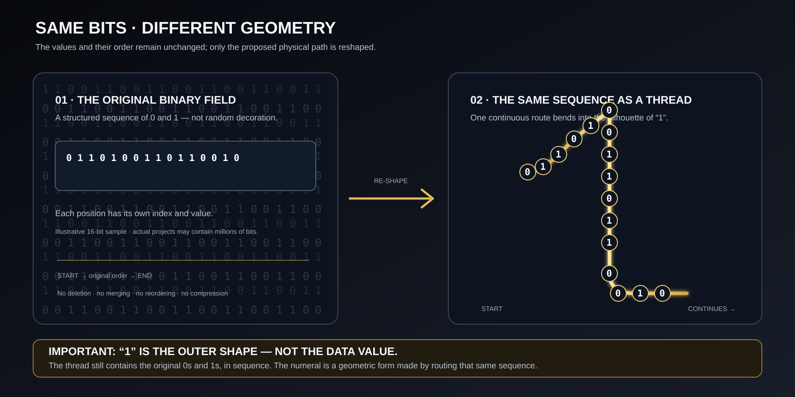

# Visual guide — understand the concept in sequence

The diagram below is a teaching aid. Read it from stage 1 to stage 7; each stage adds one idea while keeping the original bitstream unchanged.

\n\n## Focused visual — the binary sequence forms the shape of 1\n\n\n\nThe left panel shows a 16-bit example sequence: `0110100110110010`. The right panel routes those exact same 16 values, in the same order, along one continuous illustrative thread whose overall silhouette resembles the numeral **1**. The values are not replaced by a single `1`; the numeral is only the outer geometric shape made by the path. The example is schematic and does not establish that a physical material can be fabricated or read at a smaller scale.

## Stage 1 — Begin with the source image

An image is represented digitally by a finite ordered set of bits. The example pattern in the diagram is illustrative; a real image format also has dimensions, color model, and file-format metadata.

## Stage 2 — Freeze the exact bitstream

Write the stream as B = (b_0, b_1, ..., b_(N-1)). Each b_i is still exactly 0 or 1. The index is important: the bit at position 17 is not interchangeable with the bit at position 18. The project does not assume the bits are random or independent.

## Stage 3 — Give the stream a continuous geometry

Associate each original index with a position along a path. The path can be straight, serpentine, helical, or another candidate geometry. The mapping must retain the index order and the adjacency relationship between consecutive indices. A drawing of a path is not yet a physical storage medium.

## Stage 4 — Apply a common scale

A uniform scale factor s changes every coordinate by the same multiplier. In the mathematical model, this shrinks the path geometry while leaving the bit values and their indices untouched.

**Critical distinction:** scaling coordinates in software does not show that physical 0/1 states can be fabricated and reliably distinguished at that scale. Real minimum feature sizes, spacing, noise, and readout resolution may impose a lower limit.

## Stage 5 — Treat the path as one composite physical object

The concept is not “one bit replaces a million bits.” It is one physical object whose internal structure contains the complete ordered sequence. The object boundary or outer shape does not erase the internal positions or values. This panel is conceptual, not a selected material design.

## Stage 6 — Read and reconstruct

A reader must identify the start, follow the positions in order, distinguish each 0 from each 1, and recover exactly N bits. The software target is D(T(B)) = B. The physical equivalent must be demonstrated experimentally.

## Stage 7 — Establish physical feasibility

A credible physical proposal must specify the material, how 0 differs from 1, how adjacent states remain distinguishable, how the sequence is written and read, and how the structure survives noise, temperature, aging, and manufacturing tolerances. Density must be measured including spacing and the supporting read/write structures.

## Three evidence levels

| Level | What it means | Current status |
|---|---|---|
| Mathematical | Ordered sequence and coordinate mapping are well-defined | Modelled |
| Computational | Software preserves values, order, count, and exact recovery | Unit-tested |
| Physical | A real medium is fabricated and read back with measured performance | Not demonstrated |

## What the diagram intentionally does not claim

- It does not claim a million-fold reduction.
- It does not depict atoms or a real nanofabrication process.
- It does not imply that a helix alone creates storage capacity.
- It does not replace bits with a new alphabet or compress the sequence.
